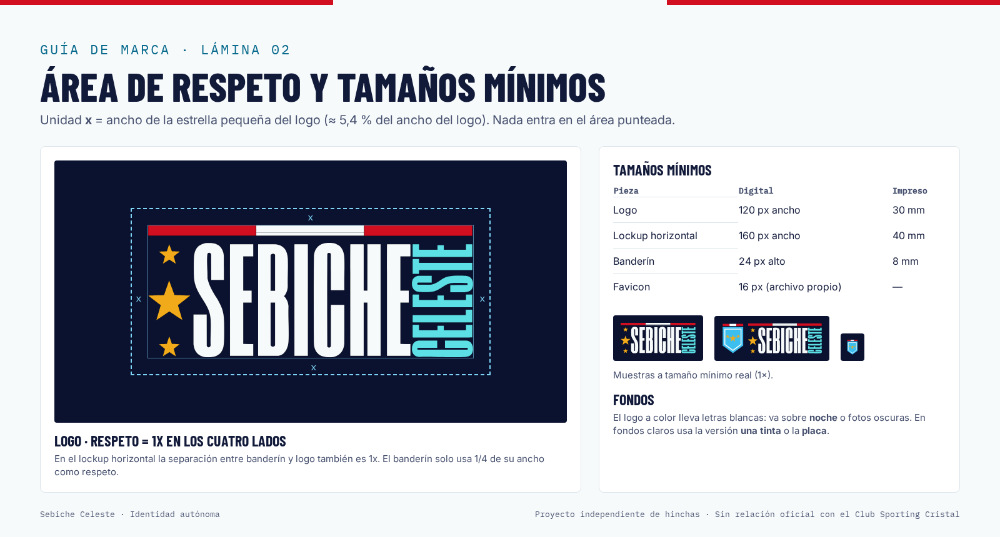
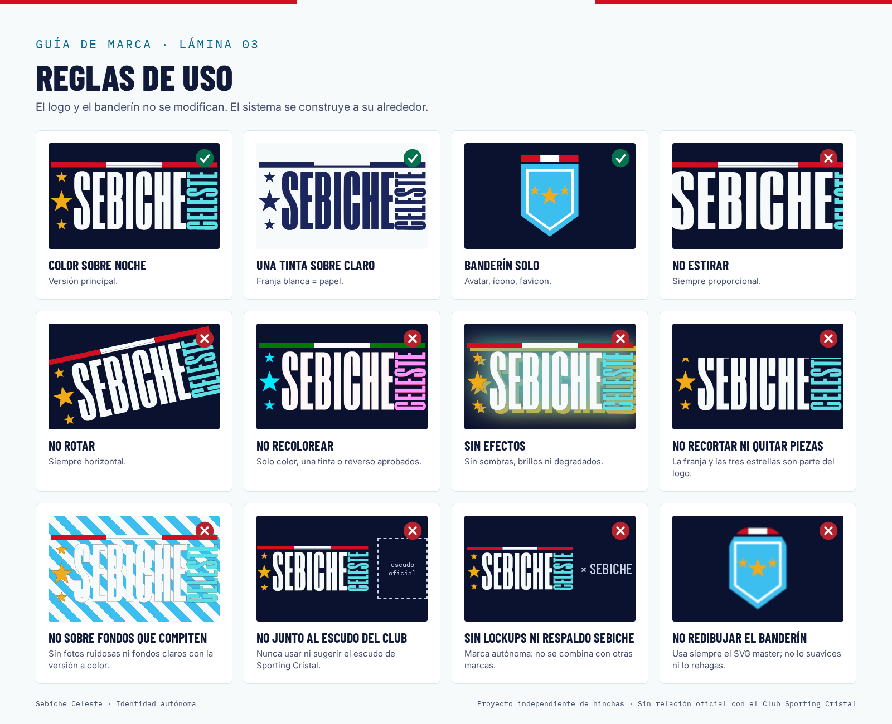

# Sebiche Celeste — Guía de marca v1

*Octubre 2026 · archivo de hinchas de Sporting Cristal*

> **Proyecto independiente de hinchas. Sin relación oficial con el Club Sporting Cristal.**
> Este aviso va en la web, en las redes y en cualquier pieza pública. Nunca se usa el escudo del club, y nunca se combina con la marca SEBICHE (ni lockups ni respaldo).

## 1. Qué es la marca

Sebiche Celeste es un archivo estadístico de Sporting Cristal: 1948 partidos registrados desde 1956. La marca tiene que sentirse **precisa, hincha y sobria**: es un archivo con datos de verdad, no una cuenta de memes.

## 2. Logo y banderín

**Logo (wordmark):** se trazó a vector **sin modificar ni un píxel** y se comprobó superponiéndolo al raster original (diferencia media 0,87; IoU alfa 0,998 contra el PNG de 6001 px). Ese trazo no se toca.

**Banderín v2 (aprobado el 24 oct 2026):** reemplaza al banderín pixel art anterior, que queda archivado en `_archive/banderin-v1/`. Está dibujado a mano en vector, con formas limpias:
- Silueta del banderín en celeste #3CBEEF, con un filete interior blanco continuo.
- Barra superior en rojo-blanco-rojo (#D10F21 / #FFFFFF / #D10F21), en tres tramos iguales y formas sólidas. Tiene exactamente el ancho del banderín: no sobresale.
- Tres estrellas rellenas oro #F1AA19 en V (chica, grande, chica), las mismas estrellas del logo.

El master es `logo/svg/sebiche-celeste-banderin-master.svg` (generado por `scripts/pen_v2.py`). Para 64 px o menos se usa la versión con filete más grueso (`banderin-v2/opcion-d-final-icon.svg`). En favicon las estrellas se leen como un punto oro, y eso es aceptado.

**Reglas del banderín v2:** no cambiar la proporción ni la posición de las estrellas, no agregar contornos a las estrellas, no hacer que la barra tricolor sobresalga del ancho del banderín, y no recolorear fuera de las versiones aprobadas.

**Versiones permitidas** (solo cambia el color, nunca la forma):
- **Color**: es la principal y va sobre fondos noche (#0B1230 a #1B265C).
- **Color con placa**: la misma versión color sobre una placa noche, para fondos claros.
- **Tinta**: una sola tinta #1B265C, para impresión o sellos (en el banderín, la franja blanca, el filete y las estrellas quedan calados).
- **Reverso**: blanco, sobre fotos o sobre colores de la marca.
- **Lockup horizontal**: banderín más logo, separados por 300 unidades (la x).

**Área de respeto:** x = ancho de la estrella pequeña, que equivale al 5,4 % del ancho del logo. Hay que dejar al menos 1x libre por cada lado.

**Tamaños mínimos:**

| Pieza | Pantalla | Impresión |
|---|---|---|
| Logo | 120 px | 30 mm |
| Lockup | 160 px | 40 mm |
| Banderín | 24 px | 8 mm |
| Favicon | 16 px | — |

## 3. Color

| Token | Hex | Uso |
|---|---|---|
| noche.950 | #0B1230 | Fondo oscuro, fondo del logo |
| noche.800 | #1B265C | Header, tinta |
| celeste.400 | #3CBEEF | Acento en oscuro, banderín |
| oro | #F1AA19 | Estrellas del logo y del banderín |
| celeste.700 | #086A8C | Acento y enlaces en claro |
| papel.50 | #F7FAFB | Fondo claro |
| oro (UI) | #F1AA19 | Marcador, destacados (en claro se usa #7A4E00) |
| rojo | #D10F21 | Franja del logo y barra del banderín (solo decorativo) |

Victoria, empate y derrota tienen tonos propios en cada tema, y **siempre van acompañados de la letra V, E o D**: nunca dependen solo del color. Todas las combinaciones de texto cumplen WCAG AA (ver `tokens/contrast-report.md`).

**Regla:** las estrellas oro sobre el celeste del banderín dan 1,07:1 de luminancia y se distinguen por el tono; por eso el banderín no se reduce a escala de grises: se usa la versión tinta. El banderín celeste sobre papel da 2,04:1. Como es un logo, está exento de la norma de contraste, pero sobre fondo claro se recomienda usar la versión *con placa* o la versión *tinta*.

Los tokens se mantienen en `tokens/tokens.json` y desde ahí se generan `tokens.css` y `tailwind.preset.cjs`.

## 4. Tipografía

Las tres son OFL y van auto-alojadas en `fonts/`. Reemplazan a Avenir, que dependía de qué fuentes tuviera instaladas cada sistema.

- **Barlow Condensed 600–800**: titulares y marcadores, en MAYÚSCULAS e interlineado de 0,92.
- **Inter**: textos y UI.
- **IBM Plex Mono**: fechas, etiquetas y datos (con espaciado de +0,1 em).

## 5. Composición

- Cuadrícula de 8 px y radios pequeños (4–8 px).
- La franja roja, blanca y roja del logo puede usarse como filete superior de 4 px.
- Áreas táctiles de 44 px como mínimo.
- Los números van con `tabular-nums`.
- Hay que respetar `prefers-reduced-motion`.

## 6. Voz

Habla un hincha que sabe de datos: con cariño, exacto y sin agrandar las cosas.

| En vez de | Escribe |
|---|---|
| "¡¡EL MÁS GRANDE!! 🔥🔥" | "6 partidos un 24 de octubre: 5 victorias." |
| "Sporting Cristal oficial" | "Archivo de hinchas de Sporting Cristal" |
| "Destrozamos a Alianza" | "Alianza Lima 1–3 SC, 24 oct 2021" |
| "Datos aproximados" | "Fuente: archivo propio, 1956–2026" |
| "Síguenos para más" | "Suscríbete al calendario de partidos" |

En la locución de videos, el cierre es: *"Sebiche Celeste es un proyecto independiente de hinchas, sin relación oficial con el Club Sporting Cristal."*

## 7. Usos prohibidos

- Usar el escudo de Sporting Cristal o cualquier marca registrada del club.
- Deformar, rotar, recolorear (fuera de las versiones aprobadas) o ponerle sombras o contornos al logo o al banderín, o volver a usar el banderín pixel art anterior.
- Formar lockups con SEBICHE o insinuar patrocinio o carácter oficial.
- Inventar datos: cada cifra tiene que salir del archivo.

## 8. Piezas y producción

| Pieza | Ruta |
|---|---|
| Logos (SVG y PNG) | `logo/` |
| Iconos y manifest | `icons/` |
| Plantillas para redes | `social/` |
| Imágenes OG | `og/` |
| Calendario .ics | `ics/` |
| UI kit | `ui-kit/` |
| Press kit | `press/` |

Las filas que el plan asignaba a *Claude Design* se entregaron como piezas finales hechas en HTML y código. Sebiche puede refinarlas en Claude Design partiendo de esos HTML.
