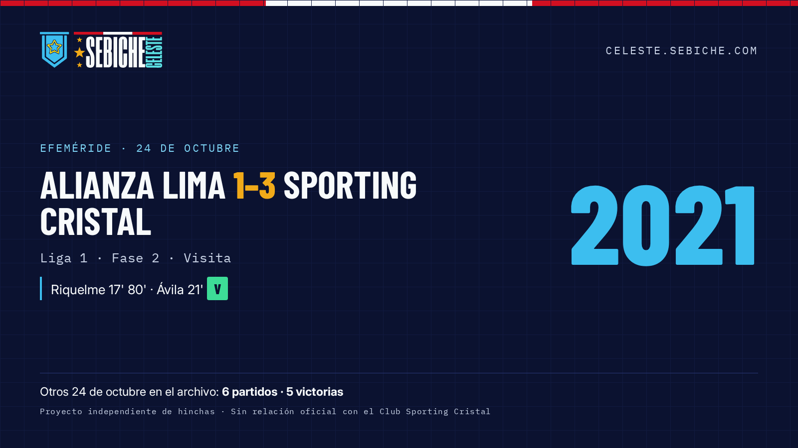
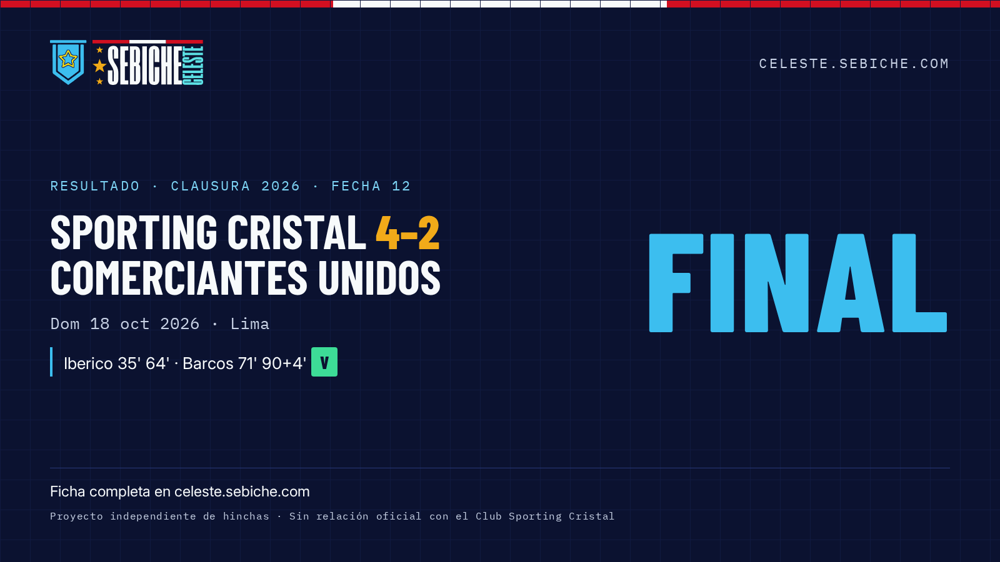

# Sebiche Celeste — Press kit

> **Proyecto independiente de hinchas. Sin relación oficial con el Club Sporting Cristal.**

## En una línea

Sebiche Celeste es el archivo abierto de Sporting Cristal: **1948 partidos desde 1956** que se pueden consultar por efeméride, por rival o por temporada, y un calendario de los próximos partidos al que uno se puede suscribir.

## Caso de estudio

**Problema.** La historia del club estaba repartida entre foros, hilos y la memoria de los hinchas. Contestar "¿cómo nos fue un 24 de octubre?" o "¿cuál es el historial contra Alianza Lima?" exigía horas de búsqueda.

**Solución.** Se unificó un archivo partido por partido y se publicó en una web rápida con tres preguntas como entrada:

- **Efemérides**: qué pasó un día como hoy.
- **Rivales**: el historial completo contra cada equipo. Por ejemplo, el clásico ante Alianza Lima: 140 partidos, con 44 victorias, 52 empates y 44 derrotas.
- **Año a año**: 71 temporadas con récord y goleadores.

**Identidad.** El banderín y el logo originales se conservaron píxel a píxel como vector verificado. Alrededor de ellos se construyó un sistema propio: paleta con contraste AA en tema claro y oscuro, tipografías libres auto-alojadas, plantillas para redes generadas con datos reales y un aviso de no afiliación en todas las piezas.

## Cifras

| Dato | Valor |
|---|---|
| Partidos registrados | 1948 |
| Período | 1956–2026 |
| Temporadas | 71 |
| Partidos ante Alianza Lima | 140 |

## Piezas descargables

- Logos (SVG y PNG; color, tinta, reverso, placa): `logo/`
- Imágenes OG y gráficas para redes: `og/`, `social/`
- Guía de marca: `guide/guia-de-marca.pdf`

## Uso por medios

Se pueden usar el logo y las capturas para notas sobre el proyecto, siempre respetando la guía de marca. No se debe presentar el proyecto como oficial del club.

**Contacto:** *(pendiente: Sebiche define el correo público)*
